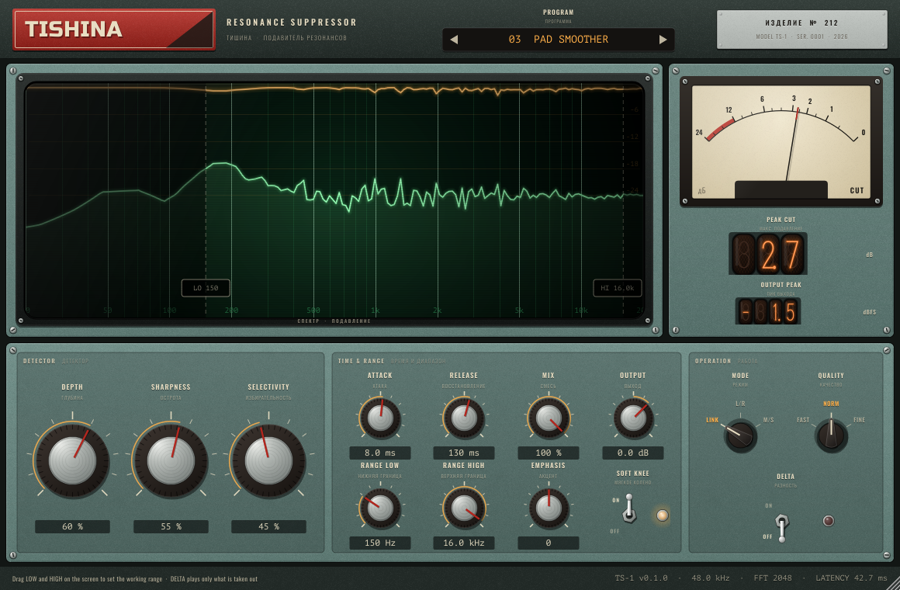

# TISHINA

A resonance suppressor in the style of a Soviet control panel (sister unit of KONVEYER). It listens for narrow
peaks that ring out of the spectrum (the whistling, honky or harsh spots that pads, synths, vocals and rooms
tend to have) and turns them down only where and when they appear. The broad tonal balance stays as it is.

## How it works

The signal is analysed in short overlapping FFT frames. For every frequency bin TISHINA compares the level with a
smoothed envelope of the spectrum around it. Whatever stands out above that envelope is a resonance and gets a
dynamic cut, bin by bin, with its own attack and release. The cut is applied in the same frames, so dry, wet and
delta are perfectly aligned.

## Controls

**Detector**
- **Depth**: how hard resonances are pulled down (and how deep a cut may go, up to 24 dB)
- **Sharpness**: high values react only to narrow peaks; low values also smooth broader build-ups
- **Selectivity**: how far a peak must stand out before it is touched; higher leaves more alone

**Time & range**
- **Attack / Release**: how fast a cut appears and lets go
- **Mix**: parallel blend with the dry signal; **Output**: level trim
- **Range low / high**: working range (also draggable on the screen); outside it nothing happens
- **Emphasis**: work harder on the highs (+) or the lows (-)
- **Soft knee**: gentle onset of the cut

**Operation**
- **Mode**: LINK (same cut on both channels), L/R (each channel on its own), M/S (mid and side on their own)
- **Quality**: FFT resolution. FAST 21 ms latency, NORM 43 ms, FINE 85 ms (the same at every sample rate)
- **Delta**: listen only to what is being removed

The screen shows the input spectrum in green and the cut in amber, hanging from the top.
Factory programs include several pad settings (Gentle, Smoother, Glassy Highs, Warm Low-Mids, Wide Sides).

## Building

Requires CMake 3.22+ and a C++17 compiler. JUCE 8.0.9 is downloaded automatically.

    cmake -B build -DCMAKE_BUILD_TYPE=Release
    cmake --build build --target Tishina_VST3 Tishina_AU

Every push to `main` builds a universal macOS VST3 + AU on GitHub Actions, runs the engine and plugin tests,
validates the VST3 with pluginval (strictness 10) and the AU with auval, and publishes a release with an installer.

Developer tools (`-DKV_DEV_TOOLS=ON`): `EditorSnapshot` renders the window to a PNG without a host,
`PluginTest` checks state, presets, quality changes and latency.

## Layout

    Source/Engine/   DSP, plain C++ without JUCE, tested by tests/EngineTest.cpp
    Source/UI/       control-panel look shared with KONVEYER
    Source/          JUCE processor, parameters, factory programs and editor
    Resources/fonts  Russo One, Oswald, PT Mono, Big Shoulders Stencil (SIL Open Font License)
