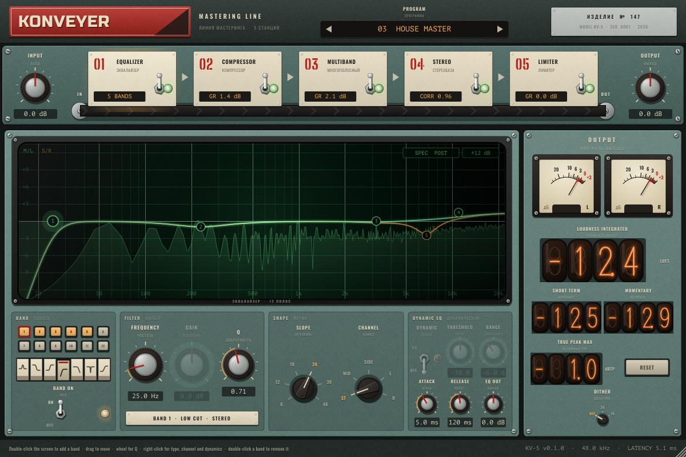

# KONVEYER

A mastering line in the style of a Soviet power-station control panel. Five stations sit on a conveyor belt:
**Equalizer, Compressor, Multiband, Stereo, Limiter**. Drag them into any order; every station can be switched
off with its lever.

## Stations

**Equalizer** (12 bands). Bell, low/high shelf, tilt, low/high cut (6 to 48 dB/oct) and notch. The curves are
analog-matched: a boost at 16 kHz keeps its analog shape at 44.1 kHz instead of being squeezed towards Nyquist.
Each band can work on Stereo, Mid, Side, Left or Right, and bell and shelf bands can be dynamic (threshold and
range, with shared attack and release). Spectrum analyser before and/or after the EQ.

- Double-click the screen to add a band, double-click a band to remove it
- Drag a band to move it (Shift for fine moves), mouse wheel over a band for Q
- Right-click a band for type, slope, channel and dynamics; right-click the screen for analyser and display range

**Compressor**. Bus compressor with soft knee, program-dependent auto release, RMS or peak detection,
sidechain high-pass and parallel mix. The transfer screen shows the curve and the live level.

**Multiband**. Four bands split by phase-aligned Linkwitz-Riley crossovers (the bands sum flat when nothing is
compressed). Drag the crossovers on the screen. Solo and bypass per band.

**Stereo**. Three-band width (0 % mono, 100 % untouched, 200 % twice as wide), mono bass below the low crossover,
goniometer and correlation meter.

**Limiter**. Look-ahead brickwall limiter with true-peak detection (4x oversampled), auto release and a scrolling
history of input, output and gain reduction. The latency stays the same when the limiter is switched off.

**Output**. Input and output gain, peak meters, integrated / short-term / momentary loudness and true-peak
maximum (ITU-R BS.1770-4), dither to 24 or 16 bit.

## Building

Requires CMake 3.22+ and a C++17 compiler. JUCE 8.0.9 is downloaded automatically.

    cmake -B build -DCMAKE_BUILD_TYPE=Release
    cmake --build build --target Konveyer_VST3 Konveyer_AU

Every push to `main` builds a universal macOS VST3 + AU on GitHub Actions, runs the engine and plugin tests,
validates the VST3 with pluginval (strictness 10) and the AU with auval, and publishes a release with an installer.

Developer tools (`-DKV_DEV_TOOLS=ON`): `EditorSnapshot` renders the window to PNGs without a host,
`PluginTest` checks state, presets and latency.

## Layout

    Source/Engine/   DSP, plain C++ without JUCE, tested by tests/EngineTest.cpp
    Source/UI/       control-panel look: knobs, levers, nixie tubes, needle meters, phosphor screens
    Source/          JUCE processor, parameters, factory programs and editor
    Resources/fonts  Russo One, Oswald, PT Mono, Big Shoulders Stencil (SIL Open Font License)
